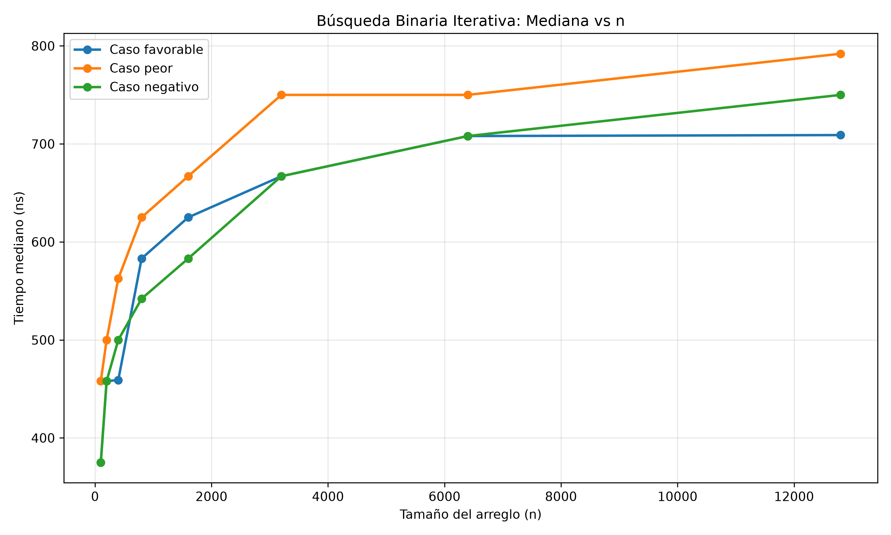
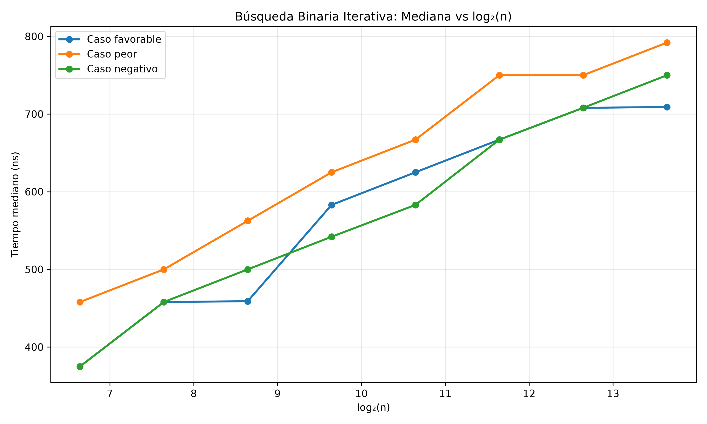
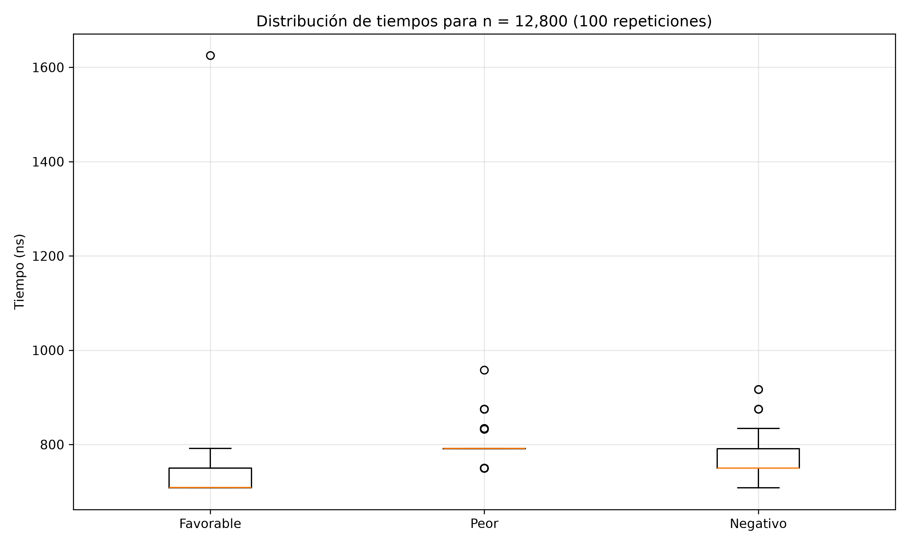

# Bitácora 1 — Búsqueda Binaria Iterativa
**Equipo 2 | Análisis y Diseño de Algoritmos | 2026-III**  
**Profa. MSc. Ana Sosa | UNIVERSIDAD NACIONAL EXPERIMENTAL DE GUAYANA**

---

## Reproducción del Experimento

### Requisitos
- Python 3.10+
- Paquetes: `pandas`, `matplotlib`, `numpy`

```bash
pip install pandas matplotlib numpy
```

### Ejecución paso a paso

```bash
# 1. Clonar repositorio
git clone https://github.com/dsalazar4446/Equipo_2_Bitacora1.git
cd Equipo_2_Bitacora1/

# 2. Generar datos empíricos (resultados.csv)
python3 pruebas_busqueda.py
# Salida esperada: "Script finalizado. Resultados en 'resultados.csv'"

# 3. Procesar datos y generar análisis + gráficas
python3 analisis_graficas.py
# Salida esperada: estadisticas.csv, grafica_lineal.png, grafica_log.png, boxplot.png, tabla_latex.txt, analisis_cotas.txt
```

### Parámetros del Experimento
| Parámetro | Valor |
|-----------|-------|
| **Tamaños (n)** | 100, 200, 400, 800, 1600, 3200, 6400, 12800 (potencias de 2 × 100) |
| **Repeticiones por caso** | 100 |
| **Casos evaluados** | Favorable (posición media), Peor (último elemento), Negativo (−1) |
| **Semilla aleatoria** | Fija (`random.seed(42)`) |
| **Medición** | `time.perf_counter_ns()` (nanosegundos) |
| **Total mediciones** | 2,400 (8 tamaños × 3 casos × 100 repeticiones) |

---

## Resultados Experimentales Clave

### Análisis de Razones T(2n)/T(n)

| Caso | Razón Promedio T(2n)/T(n) | Interpretación |
|------|---------------------------|----------------|
| **Favorable** | **1.099** | ~1.0 confirma crecimiento logarítmico (al duplicar n se añade ~1 iteración) |
| **Peor** | **1.082** | ~1.0 confirma crecimiento logarítmico |
| **Negativo** | **1.105** | ~1.0 confirma crecimiento logarítmico |

> **Conclusión:** Las tres razones cercanas a 1.0 validan que T(n) ∈ Θ(log₂ n), ya que T(2n) ≈ T(n) + constante.

### Modelos de Regresión Logarítmica (T(n) = α·log₂ n + β)

| Caso | Modelo Ajustado | R² | Cota Propuesta (n ≥ 100) |
|------|-----------------|-----|--------------------------|
| **Favorable** | `50.64·log₂(n) + 59.29` | **0.947** | `T(n) ≤ 50.6·log₂(n) + 59.3` |
| **Peor** | `49.91·log₂(n) + 131.78` | **0.978** | `T(n) ≤ 49.9·log₂(n) + 131.8` |
| **Negativo** | `52.58·log₂(n) + 39.48` | **0.991** | `T(n) ≤ 52.6·log₂(n) + 39.5` |

> **Interpretación:** Todos los casos presentan R² > 0.94, confirmando el comportamiento teórico Θ(log n). El caso Negativo muestra el mejor ajuste (R² = 0.991).

### Estadísticas Resumidas (Mediana en nanosegundos)

| n | Favorable | Peor | Negativo |
|---|-----------|------|----------|
| 100 | 375 | 458 | 375 |
| 200 | 458 | 500 | 458 |
| 400 | 459 | 562.5 | 500 |
| 800 | 583 | 625 | 542 |
| 1600 | 625 | 667 | 583 |
| 3200 | 667 | 750 | 667 |
| 6400 | 708 | 750 | 708 |
| 12800 | 709 | 792 | 750 |

---

## Gráficas Generadas

### 1. Gráfica Lineal — `grafica_lineal.png`
**Mediana vs n (escala lineal)**  
Muestra la curva característica de crecimiento logarítmico: el tiempo aumenta rápidamente al principio y luego se aplana visiblemente. Los tres casos muestran trayectorias paralelas confirmando el mismo orden de crecimiento.



### 2. Gráfica Logarítmica — `grafica_log.png`
**Mediana vs log₂(n)**  
Al graficar contra log₂(n), los puntos se alinean casi perfectamente en líneas rectas, demostrando la relación lineal T(n) ∝ log₂(n). Las pendientes son ~50 ns por nivel de log₂(n).



### 3. Boxplot — `boxplot.png`
**Distribución de tiempos para n = 12,800 (100 repeticiones)**  
- **Caso Favorable**: Mayor variabilidad (algunas ejecuciones terminan en 1 iteración, otras en 2 por cold-start)
- **Caso Peor**: Distribución muy estable, todos requieren altura completa del árbol
- **Caso Negativo**: Muy estable, idéntico al caso Peor en comportamiento



---

## Contenido de la Entrega

| Archivo | Descripción |
|---------|-------------|
| `informe_bitacora1.md` | Informe técnico completo (Markdown) |
| `informe_bitacora1.docx` | Informe en formato Word |
| `pruebas_busqueda.py` | Script de medición empírica |
| `analisis_graficas.py` | Script de análisis y generación de gráficas |
| `resultados.csv` | Datos crudos (2,400 mediciones) |
| `estadisticas.csv` | Mediana, Q1, Q3 por n y caso |
| `analisis_cotas.txt` | Razones T(2n)/T(n), modelos de regresión, cotas |
| `tabla_latex.txt` | Tabla LaTeX lista para compilar |
| `grafica_lineal.png` | Mediana vs n (escala lineal) |
| `grafica_log.png` | Mediana vs log₂(n) (escala logarítmica) |
| `boxplot.png` | Distribución n=12,800 (100 repeticiones) |
| `resumen_analisis.txt` | Resumen numérico del ajuste |

---

## Estructura del Informe (pautas cumplidas)

1. **Problema y Especificación** — Entradas, salidas, pre/postcondiciones formales
2. **Demostración de Corrección** — Pseudocódigo + Invariante de ciclo (3 momentos) + Terminación
3. **Análisis de Costo** — Operación dominante, recurrencia, Teorema Maestro, casos mejor/peor/promedio, cotas
4. **Pruebas Empíricas** — Metodología, tablas, gráficas (lineal, log-log, boxplot), contraste teoría vs. práctica
5. **Conclusiones** — 4 puntos: correctitud, complejidad, comportamiento casos, reproducibilidad

---

## Defensa Oral

Ver `GUIA_DEFENSA_BITACORA1.md` (en carpeta superior) para el guion completo de 15 minutos (5 integrantes × 3 min c/u).

---

## Contacto

**Equipo 2** — Análisis y Diseño de Algoritmos — 2026-III  
Universidad Nacional Experimental de Guayana